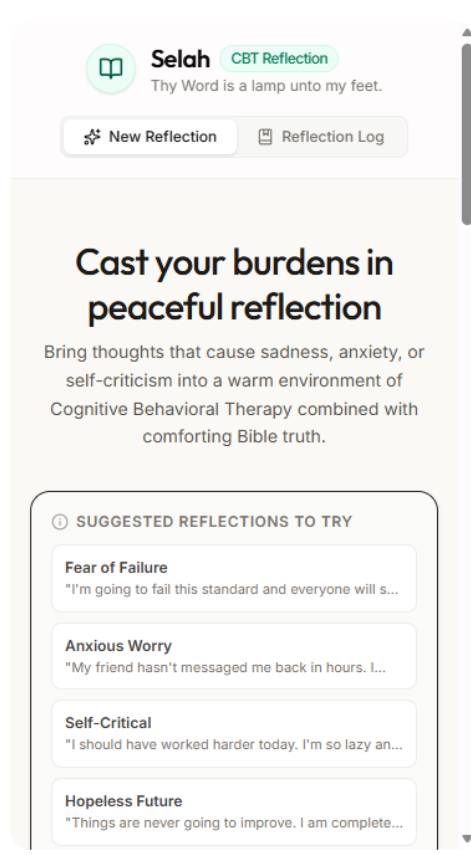
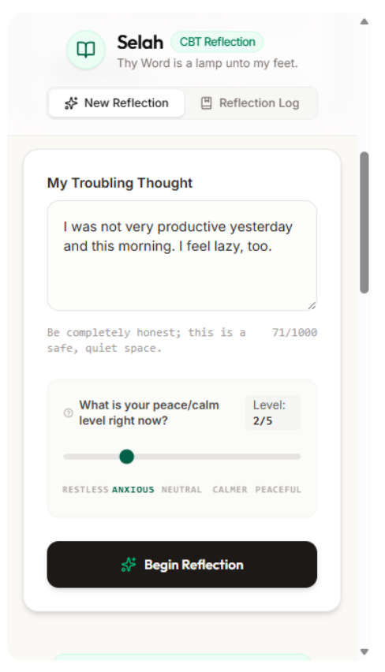
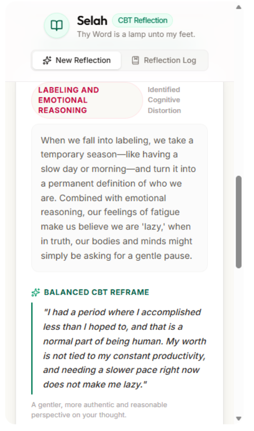
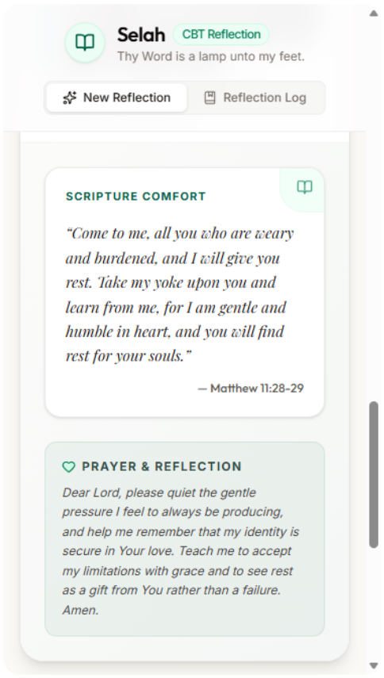
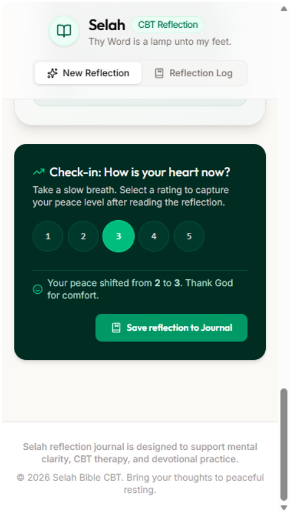

# Selah — CBT Bible Reflection App

Selah is a gentle AI reflection app that helps users process anxious, self-critical, or troubling thoughts through a blend of **Cognitive Behavioral Therapy (CBT)** and **Biblical encouragement**.

The app invites the user to write a difficult thought, then responds with a structured reflection: the likely cognitive distortion, a compassionate explanation, a kinder reframe, a relevant Bible verse, and a short prayer or reflection question.

> “Selah” means pause.  
> This app was built as a quiet space for slowing down, noticing thoughts, and returning to truth with gentleness.

---

## Live / AI Studio Version

View the app in AI Studio:  
https://ai.studio/apps/34718e49-2419-4689-83ca-fa35e15ac806

---

## Screenshots

### Home / Suggested Reflections


### New Reflection


### CBT Distortion + Reframe


### Scripture Comfort + Prayer


### Check-in + Save to Journal


---

## What the App Does

For each user-submitted thought, Selah generates:

- **Cognitive distortion detection**  
  Identifies patterns such as catastrophizing, all-or-nothing thinking, mind reading, emotional reasoning, self-blame, hopeless thinking, labeling, and “should” statements.

- **Gentle CBT explanation**  
  Explains the thought pattern in simple, non-clinical language.

- **Balanced reframe**  
  Offers a kinder and more realistic way to view the thought.

- **Bible verse support**  
  Provides a relevant verse with reference.

- **Prayer or reflection question**  
  Ends with a short spiritual prompt to help the user pause and reflect.

- **Reflection log structure**  
  Uses typed reflection entries that can support journaling and future saved-history features.

---

## Why I Built This

Selah began as a personal experiment in combining emotional self-awareness, Christian reflection, and AI-assisted journaling.

The goal was not to build a replacement for therapy, spiritual direction, or pastoral care. Instead, Selah is designed as a supportive reflection tool: a quiet companion that helps users pause, identify unhelpful thought patterns, and reframe them with compassion and hope.

This project also demonstrates my interest in building **humane AI tools** — applications that are emotionally gentle, structured, user-centered, and grounded in real-life needs.

---

## My Role

**AI Product Designer • Prompt/System Designer • Frontend/Backend Prototyper**

For this project, I worked on:

- Product concept and user flow
- CBT + Bible reflection structure
- System prompt design
- AI response schema design
- Frontend interaction flow
- Reflection result data structure
- Gemini API integration
- Error handling and retry logic
- Basic rate limiting for responsible usage
- Portfolio documentation and product positioning

---

## Tech Stack

- **Frontend:** React, TypeScript, Vite
- **Backend:** Express, Node.js, TypeScript
- **AI Model:** Google Gemini via `@google/genai`
- **Styling/UI:** Tailwind CSS, Lucide React icons, Motion
- **Environment:** Local environment variables for API key management

---

## Architecture

High-level flow:

```text
User Thought
   ↓
React Frontend
   ↓
POST /api/reflect
   ↓
Express Server
   ↓
Gemini API with structured system instruction
   ↓
Strict JSON Response
   ↓
Reflection Result Displayed in UI
```

The backend sends the user’s thought to Gemini with a carefully designed system instruction. The model is asked to return a strict JSON object with the following fields:

```json
{
  "distortionName": "Catastrophizing",
  "distortionExplanation": "A gentle explanation of the thought pattern.",
  "reframe": "A kinder and more balanced way to view the thought.",
  "bibleVerse": "Full Bible verse text.",
  "bibleVerseReference": "Philippians 4:6-7",
  "prayerOrQuestion": "A short prayer or reflection question."
}
```

---

## Key Features

### CBT-Based Thought Reflection

Selah identifies common cognitive distortions, including:

- Catastrophizing
- All-or-nothing thinking
- Mind reading
- Overgeneralization
- Emotional reasoning
- Personalization and self-blame
- Hopeless thinking
- Labeling
- Should statements

### Biblical Encouragement

Each reflection includes a relevant Bible verse chosen to respond to the user’s emotional or spiritual need.

### Structured AI Output

The app uses a defined JSON schema so the AI response can be parsed reliably and displayed cleanly in the UI.

### Gentle Tone Design

The system instruction emphasizes a warm, compassionate, calming tone. The app intentionally avoids harsh, overly clinical, or judgmental language.

### Basic Responsible Use Limit

The backend includes a simple daily rate limit per IP address to encourage slower, more reflective use rather than compulsive repeated prompting.

---

## Run Locally

### Prerequisites

- Node.js
- Gemini API key

### Installation

```bash
npm install
```

### Environment Setup

This app needs a Gemini API key to generate reflections.

1. Create a file named `.env.local` in the project root.
2. Add your Gemini API key inside it:

```env
GEMINI_API_KEY=your_api_key_here
```

You can also copy `.env.example` as a starting point, then replace the placeholder value with your own key.

> **Important:** Do not commit your real `.env.local` file or API key to GitHub. This repository’s `.gitignore` is already configured to ignore `.env*` files while allowing `.env.example` as a safe template.

### Start Development Server

```bash
npm run dev
```

### Build

```bash
npm run build
```

### Start Production Build

```bash
npm start
```

---

## Current Status

Selah is currently an MVP/prototype.

Working features include:

- User thought input
- AI-generated CBT + Bible reflection
- Structured JSON response parsing
- Reflection result display
- Basic daily usage limit
- Error handling and retry logic
- Screenshot documentation for portfolio review

Planned improvements:

- Saved reflection history
- Export journal entries
- Better devotional journal layout
- User-selected tone modes
- Optional non-religious CBT-only mode
- Mobile version refinement
- Stronger safety language for crisis situations
- Better deployment documentation
- Demo video

---

## Safety Note

Selah is a reflection and journaling aid. It is not a therapist, medical tool, crisis service, or substitute for professional mental health care, pastoral counseling, or spiritual direction.

If someone is in immediate danger, considering self-harm, or experiencing a mental health emergency, they should contact local emergency services or a qualified crisis hotline.

---

## Portfolio Notes

This project demonstrates:

- AI product thinking
- Prompt and system instruction design
- Structured LLM output design
- React + TypeScript frontend development
- Express backend development
- Gemini API integration
- Ethical and faith-sensitive UX design
- Practical MVP development using modern AI tools

---

## Contact

Portfolio: https://sites.google.com/view/featheredworks/home  
GitHub: https://github.com/whitequill-software
